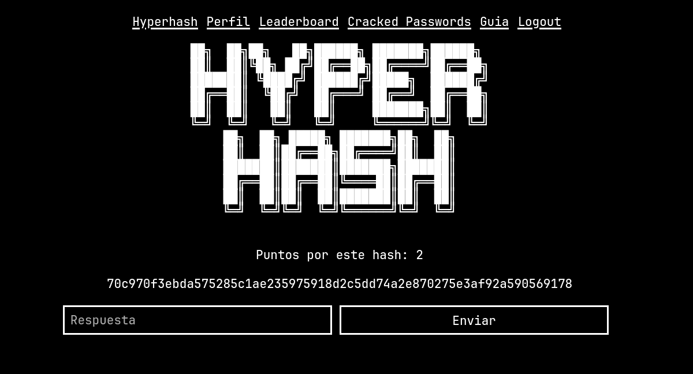
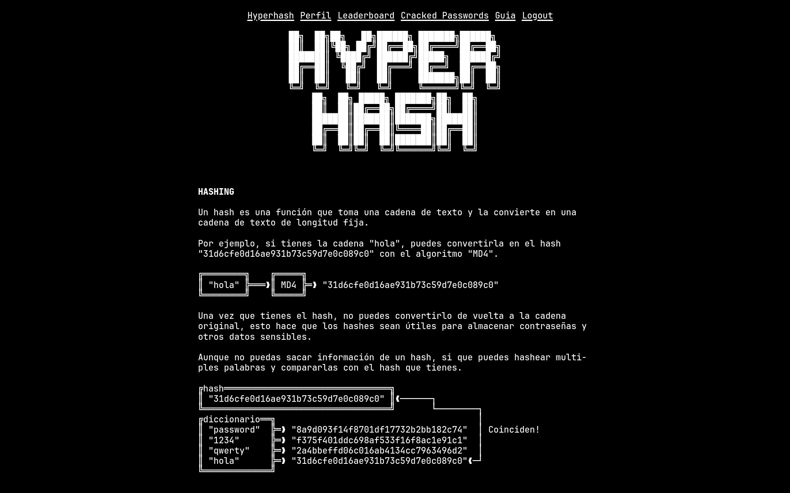

Juego multijugador de cracking de hashes.

Proyecto creado durante mis clases en ciberseguridad. Con el objetivo no solo de formar en cuanto a cracking, sino de interactuar con la api y automatizar el proceso.

Cada jugador crea una cuenta, advirtiendo a los jugadores que **no reutilicen una contraseña usada en otros servicios**, el servidor crea un hash y lo expone en la página principal, quien primero lo rompa gana puntos, los puntos obtenidos van creciendo conforme pasa el tiempo sin romperse la contraseña. Hay un leaderboard global donde los jugadores se clasifican por puntos, y una guia para repasar los conceptos básicos de hashing y descargar los diccionarios de palabras que se usan en la generación de hashes.

Si simplemente nos limitaramos a generar hashes a partir de estos diccionarios el juego sería bastante aburrido, asi que muchos se generan mediante combinación de estos, o añadiendo palabras que no vienen incluidas pero se referencian en la guia de la página, desde series numéricas, a nombres de ciudades o personas.

La primera sesión de juego suele ser bastante manual, el alumno ya ha realizado algunos ejercicios usando `hashcat` y `john` para romper algunos hashes. En las siguientes sesiones los usuarios no tienen por qué trabajar manualmente, se permite automatizar todo mediante una API HTTP expuesta a la que pueden llamar para obtener el hash publicado y mandar la respuesta. En última instancia el alumno acaba con pequeño script que va probando combinaciones hasta romperlo, publica la respuesta automáticamente y luego obtiene el nuevo hash publicado para seguir acumulando puntos.

>Hay un rate-limit al endpoint de enviar respuesta para evitar que hagan fuerza bruta sin intentar romper el hash.

Generalmente lleva entorno a 3 sesiones separadas en algunos dias hasta que los alumnos comienzan a automatizar todo el proceso, quien siga trabajando de forma manual se ve forzado a hacerlo si quiere competir con el resto.

En algunos casos, algunos alumnos usaban tanto su propio sistema **como un VPS externo** para obtener mas poder de procesamiento y poder seguir acumulando puntos sin estar presentes en el PC.

En algunos casos, me sorprendieron con cosas que no había tenido en cuenta que podrían ser útiles, como esperar a que el valor de los puntos alcanzara cierto valor para intentar acumular más y hacer perder el tiempo a quienes aún estaban trabajando manualmente, incluso a riesgo de que otros lo pudieran romper.

Finalmente, la aplicación incialmente era **deliveradamente insegura**, la api expone contraseñas de usuarios, e incluso **te deja automatizar otorgarte puntos** y hasta **borrar usuarios**, como última práctica para exponer problemas de aplicaciones web comunes. Esto se acabó quitando en el proyecto actual.

Obtuve un resultado muy positivo durante las clases, los alumnos disfrutaron mucho el proceso y aprendieron no solo a crackear hashes, sino a scriptar todo el proceso y mejoró mucho su entendimiento sobre APIs.
